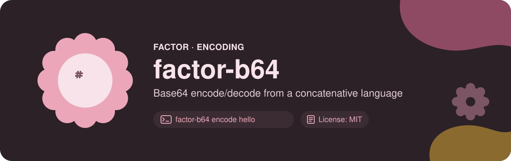
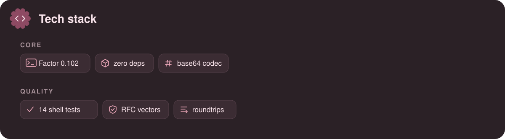

<p align="center">
  
</p>
<p align="center">
  <a href="https://github.com/Celine1337/factor-b64/releases"></a>
  <a href="https://www.rfc-editor.org/rfc/rfc4648"></a>
  <a href="LICENSE"></a>
</p>


**factor-b64** is a tiny **Base64 encoder/decoder** written in [Factor](https://factorcode.org), a stack-based concatenative language. It turns text into Base64 and back, using Factor's built-in `base64` vocabulary, with a plain CLI: `factor-b64 encode <text>` / `factor-b64 decode <b64>`. Multiple words are joined with a single space, so `encode hello world` behaves exactly like `encode "hello world"`.

Why Factor? Because it is one of the most distinctive languages still showing up in GitHub's language stats — a genuine concatenative language where the whole program is a composition of stack operations. A Base64 codec is a perfect, honest showcase: real work, a few lines of postfix code, and a test suite pinned to the RFC 4648 reference vectors.


- **Encode & decode** — standard Base64 (with `=` padding) both directions.
- **RFC 4648 test vectors** — the suite asserts the canonical `""`, `f`, `fo`, `foo`, `foob`, `fooba`, `foobar` encodings, not just a happy path.
- **Roundtrip-safe** — punctuation, spaces and mixed case survive encode→decode unchanged.
- **Argument joining** — trailing words are joined with one space, matching shell intuition.
- **Zero dependencies** — one Factor source file plus the language's standard `base64` vocabulary.
- **Honest launcher** — the system `factor` on many boxes is GNU coreutils (prime factorization), *not* the language; `build.sh` points at the real Factor binary explicitly (override with `FACTOR_BIN`).




Requires the [Factor language](https://factorcode.org) (0.99+). If `factor` on your PATH is the coreutils tool, set `FACTOR_BIN` to the real binary.

```bash
git clone https://github.com/Celine1337/factor-b64.git
cd factor-b64
./build.sh                       # writes bin/factor-b64
./bin/factor-b64 encode hello
```

Or run the source directly with the Factor binary:

```bash
/path/to/factor src/main.factor encode hello
```


```bash
factor-b64 encode hello world      # -> aGVsbG8gd29ybGQ=
factor-b64 decode aGVsbG8=         # -> hello
factor-b64 encode foobar           # -> Zm9vYmFy
```

```text
$ factor-b64 encode "round trip!"
cm91bmQgdHJpcCE=
$ factor-b64 decode cm91bmQgdHJpcCE=
round trip!
```


MIT — see [LICENSE](LICENSE).